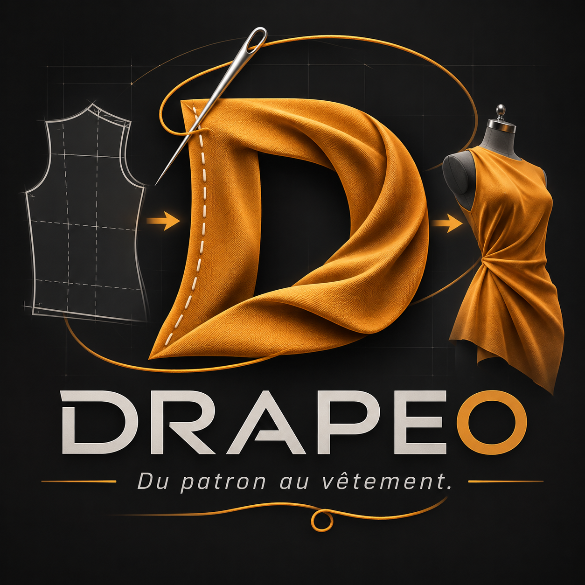
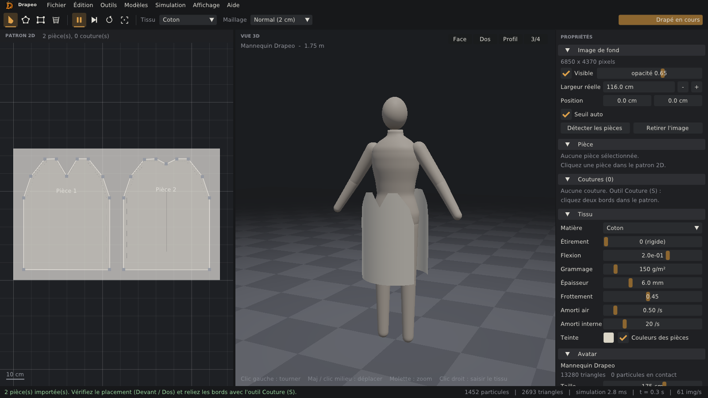

<p align="center"></p>

# Drapeo — du patron au vêtement

Logiciel original de création de vêtements 3D : on dessine des **patrons 2D**, on relie les bords par des **coutures**, et Drapeo **coud et drape** le vêtement sur un avatar par simulation physique de tissu.


## Télécharger (Windows)

[**Télécharger drapeo.exe**](https://github.com/Panics78390/drapeo/raw/main/windows/drapeo.exe) : un seul fichier, aucune installation. Windows SmartScreen peut afficher « Windows a protégé votre ordinateur » (l'exe n'est pas signé) : **Informations complémentaires → Exécuter quand même**.

## Fonctions

- **Éditeur de patrons 2D** : outils Sélection (V), Polygone (P), Rectangle (B), Couture (S) ; double-clic sur un bord pour ajouter un point, Maj pour aimanter à la grille de 1 cm, copie miroir, cotes des bords.
- **Coutures** numérotées et colorées, inversion du sens, alerte quand les deux côtés n'ont pas la même longueur. Une couture peut suivre **plusieurs bords** (emmanchure, encolure, entrejambe) : boutons + / − de l'inspecteur, ou Maj + clic sur le bord voisin.
- **Placement** de chaque pièce autour du corps : **buste, bras gauche / droit, jambe gauche / droite** (devant, dos, côtés, hauteur, distance). Simulation en pause, un clic sur une pièce dans la vue 3D affiche un **gizmo** : flèches X / Y / Z, carrés de plan, anneaux de rotation, et disque central pour glisser la pièce autour du corps.
- **Futures coutures visibles en 3D** (bouton « Coutures ») : un clic (Alt + clic si elle passe derrière le tissu) **active ou désactive** une couture ; une couture désactivée n'est pas cousue.
- **Projets .drapeo** : Fichier → Enregistrer le projet (Ctrl+S) ; on le rouvre par Ctrl+I ou glisser-déposer.
- **Simulation XPBD** : étirement, flexion, collisions avec l'avatar (BVH), auto-collisions, frottement ; les coutures se resserrent puis la gravité agit.
- **Tissus** : coton, soie, denim, cuir, réglables (grammage, épaisseur, raideur, amortissement).
- **Avatar** : mannequin intégré, ou import **FBX / OBJ** (glisser-déposer accepté), taille et rotation réglables.
- **Import de patrons** : SVG, DXF, **PDF** (vectoriel, ou scanné) et **images PNG / JPEG** (scan ou photo). L'image s'affiche en calque à l'échelle sous le patron, et les pièces sont **détectées automatiquement** (traits ou pièces sombres sur papier clair) ; sinon on les trace par-dessus.
- **Export du vêtement drapé en OBJ** (UV = patron 2D, un groupe par pièce).
- Modèles prêts à l'emploi : débardeur, jupe, robe. Annuler / rétablir (Ctrl+Z / Ctrl+Y).

## Compiler

Prérequis : un compilateur C++20 (MSVC 2022, GCC 11+, Clang 14+), CMake 3.20+, Git, et un accès Internet au premier configure (glm, GLFW et Dear ImGui sont téléchargés automatiquement).

### Windows (Visual Studio 2022)

```bat
cmake -S . -B build
cmake --build build --config Release
build\Release\drapeo.exe
```

### Linux

```bash
sudo apt install build-essential cmake git libx11-dev libxrandr-dev libxinerama-dev libxcursor-dev libxi-dev libgl-dev
cmake -S . -B build -DCMAKE_BUILD_TYPE=Release
cmake --build build -j
./build/drapeo
```

### macOS

```bash
cmake -S . -B build -DCMAKE_BUILD_TYPE=Release
cmake --build build -j
./build/drapeo
```

### Tests unitaires (sans fenêtre)

```bash
cmake -S . -B build-tests -DDRAPEO_BUILD_APP=OFF
cmake --build build-tests
ctest --test-dir build-tests --output-on-failure
```

## Importer un patron (PDF, PNG, JPEG, SVG, DXF)

Menu **Fichier → Importer un patron...** (Ctrl+I) ou glisser-déposer le fichier sur la fenêtre.

- **PDF vectoriel** (patrons vendus en PDF) : les contours fermés deviennent des pièces, à l'échelle réelle. Les petits tracés (crans, texte) et les lignes de couture intérieures sont ignorés. Les pages d'un PDF de plusieurs planches sont posées côte à côte, et chaque pièce prend le nom de son repère (« H3 DEVANT DU BUSTE »).
- **Image ou PDF scanné** : indiquez la **largeur réelle** de l'image (préremplie si le fichier contient sa résolution), cochez **Détecter les pièces**. L'image reste en calque ; dans le panneau **Image de fond** on règle l'opacité, l'échelle, la position et le seuil, puis on relance la détection. Dans la vue 2D, un clic sur l'image la sélectionne (cadre orange) : on la glisse pour la déplacer et **Suppr** la retire. **Fichier > Nouveau vêtement** repart d'un patron vide, sans image.
- Après l'import : placez chaque pièce (Devant / Dos) et reliez les bords avec l'outil **Couture**.



## Aimant, symétrie, ajouter ou découper une forme

- **Aimant** (bouton en U de la barre d'outils, touche **M**) : un point tiré, un point de polygone ou un coin de
  rectangle s'accroche au point ou au bord le plus proche d'une autre pièce ; une pièce glissée accroche ses
  points à ceux des pièces voisines. Un cercle rose montre l'accroche. Maj garde la grille de 1 cm.
- **Symétrie** (bouton à côté de l'aimant, ou Propriétés > Symétrie) : la pièce reçoit un axe vertical en son milieu (pointillés bleus) ;
  un point déplacé, ajouté (double-clic sur un bord) ou supprimé l'est aussi de l'autre côté.
- **Ajouter ou découper** : tracez une forme (polygone, rectangle) qui chevauche le bord d'une pièce, puis
  **Ajouter à la pièce** (réunion) ou **Découper dans la pièce** (encoche, échancrure). Les coutures des bords
  restés intacts sont gardées. Une découpe qui ferait un trou au milieu est refusée.

## Cintrer

Dans **Propriétés > Cintrer**, on resserre ou on élargit la pièce sélectionnée (ou toutes les pièces sélectionnées
au rectangle / Maj+clic) d'un pourcentage, **surtout en bas**, **au milieu** (taille d'une robe ou d'une combinaison),
**en haut** ou partout, en gardant fixe le centre ou un bord (le milieu devant, par exemple). Les poches cousues suivent.
Ctrl+Z annule.

## Droit fil

Chaque pièce porte une flèche de droit fil dans le patron (verticale par défaut). On la règle dans
**Propriétés > Droit fil** (curseur, ou boutons vertical / biais / horizontal) ; elle est enregistrée dans le projet.
La flèche de la pièce sélectionnée est aussi reportée sur le tissu dans la vue 3D, pour voir le sens de la pièce sur le corps.

## Coudre une poche sur le vêtement

1. Dessinez la poche (outil Rectangle ou Polygone) ou importez-la, puis posez-la sur la pièce voulue dans le patron 2D.
2. Dans **Propriétés > Coudre sur une pièce**, la pièce située dessous est proposée ; choisissez la façon de coudre :
   **Poche** (ouverte en haut), **Rabat** (cousu en haut) ou **Tout le tour** (renfort, écusson, bande).
3. Cliquez **Coudre sur la pièce**. La poche est cousue en 3D sur le tissu et suit sa base.

Glissez la poche dans le patron pour la déplacer sur sa base ; déplacer la base emporte ses poches.
**Détacher de la pièce** la libère.

## Importer un avatar (FBX, OBJ)

- menu **Fichier → Importer un avatar (FBX, OBJ)...** (Ctrl+O), ou
- glisser-déposer un fichier `.fbx` / `.obj` sur la fenêtre, ou
- `drapeo mon_personnage.fbx` en ligne de commande.

L'avatar est converti en mètres, axe Y vers le haut, posé au sol et centré. Si sa taille n'a pas l'air d'être en mètres (fichier en cm ou sans unité), il est mis à 1,75 m ; réglez ensuite **Taille** et **Rotation** dans le panneau Avatar. Le vêtement est replacé et recousu sur le nouveau corps (collisions via un BVH des triangles). Les personnages riggés sont importés dans leur pose de liaison (T-pose ou A-pose en général).

Un mannequin de test original est fourni : `assets/mannequin.obj` (généré par `tools/make_mannequin.py`).

Au démarrage, Drapeo recharge le dernier avatar utilisé (mémorisé dans `%APPDATA%\Drapeo\reglages.txt`). La première fois, il prend le premier `.fbx` (ou `.obj`) placé à côté de `drapeo.exe`.

## Commandes

| Action | Geste |
| --- | --- |
| Tourner autour de la vue 3D | clic gauche + glisser |
| Zoom | molette |
| Déplacer la vue | Maj + clic gauche, ou clic milieu |
| Saisir le tissu | clic droit maintenu |
| Lecture / pause | Espace |
| Sélection rectangle (patron 2D) | glisser dans le vide ; Maj pour ajouter, Maj + clic pour basculer une pièce |
| Tout sélectionner / désélectionner (patron 2D) | Ctrl+A / Échap |
| Recoudre depuis le patron | R |
| Cadrer la vue survolée | F |
| Annuler / rétablir | Ctrl+Z / Ctrl+Y |
| Importer avatar / patron | Ctrl+O / Ctrl+I |
| Exporter en OBJ | Ctrl+E |

Options : `drapeo --frames 200 --screenshot capture.ppm --size 1600x900` lance 200 images puis enregistre une capture (utile pour les tests automatiques).

## Organisation du code

```
src/
  geometry/    ClothMesh, TriangleBvh, Mannequin intégré
  garment/     Pattern (pièces, coutures, modèles), GarmentMesher (triangulation CDT, placement)
  simulation/  XpbdSolver (XPBD à petits pas, coutures), SpatialHash (auto-collisions), Materials
  io/          MeshImport (FBX/OBJ via ufbx), PatternImport (SVG/DXF), PdfImport, RasterImage
               (images + détection des pièces), GarmentExport (OBJ)
  rendering/   GlFunctions (chargeur OpenGL sans dépendance), Shader, Camera, Renderer (PBR)
  ui/          PatternEditor (éditeur 2D)
  app/         App (fenêtre, menus, inspecteur), FileDialog, logo intégré
tools/         make_mannequin.py, make_logo_assets.py
third_party/   stb_image (domaine public)
tests/         tests du cœur, sans OpenGL
```

`geometry`, `garment`, `io` et `simulation` forment la bibliothèque `drapeo_core`, qui ne dépend ni d'OpenGL ni de l'interface.

## Paramètres du solveur

- **Compliance d'étirement / de flexion** (m/N) : 0 = rigide ; plus grand = plus souple. Indépendante du nombre de sous-pas.
- **Grammage** : masse surfacique, répartie sur les particules selon l'aire des triangles.
- **Épaisseur** : distance gardée entre le tissu et les obstacles.
- **Amortissement air / interne** : le premier freine tout le tissu, le second lisse les vitesses voisines et supprime l'effet « coup de fouet » des bords.
- **Sous-pas** : 15 par défaut à 60 images/s. Plus de sous-pas = tissu plus raide et plus précis, mais plus coûteux.

## Prochaines étapes

Points de couture libres (bord partiel), pinces et plis, épaisseur et superposition de couches, textures de tissu, sauvegarde de projet, export FBX / glTF, avatars animés.
