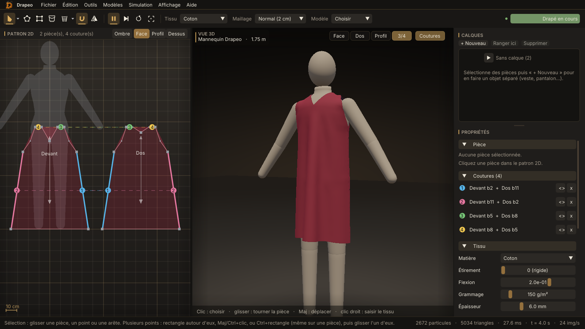

<p align="center"></p>

# Drapeo — du patron au vêtement

Logiciel original de création de vêtements 3D : on dessine des **patrons 2D**, on relie les bords par des **coutures**, et Drapeo **coud et drape** le vêtement sur un avatar par simulation physique de tissu.



## Télécharger (Windows)

[**Télécharger drapeo.exe**](https://github.com/Panics78390/drapeo/raw/main/windows/drapeo.exe) : un seul fichier, aucune installation. Windows SmartScreen peut afficher « Windows a protégé votre ordinateur » (l'exe n'est pas signé) : **Informations complémentaires → Exécuter quand même**.

## Fonctions

- **Éditeur de patrons 2D** : outils Sélection (V), Polygone (P), Rectangle (B), Couture (S) ; double-clic sur un bord pour ajouter un point, Maj pour aimanter à la grille de 1 cm, copie miroir, cotes des bords.
- **Coutures** numérotées et colorées, inversion du sens, alerte quand les deux bords n'ont pas la même longueur.
- **Placement** de chaque pièce autour du corps (devant, dos, côtés, hauteur, distance).
- **Simulation XPBD** : étirement, flexion, collisions avec l'avatar (BVH), auto-collisions, frottement ; les coutures se resserrent puis la gravité agit.
- **Tissus** : coton, soie, denim, cuir, réglables (grammage, épaisseur, raideur, amortissement).
- **Avatar** : mannequin intégré, ou import **FBX / OBJ** (glisser-déposer accepté), taille et rotation réglables.
- **Import de patrons SVG / DXF**, **export du vêtement drapé en OBJ** (UV = patron 2D, un groupe par pièce).
- Modèles prêts à l'emploi : débardeur, jupe, robe. Annuler / rétablir (Ctrl+Z / Ctrl+Y).

## Compiler

Prérequis : un compilateur C++20 (MSVC 2022, GCC 11+, Clang 14+), CMake 3.20+, Git, et un accès Internet au premier configure (glm, GLFW et Dear ImGui sont téléchargés automatiquement).

### Windows (Visual Studio 2022)

```bat
cmake -S . -B build
cmake --build build --config Release
build\Release\drapeo.exe
```

### Linux

```bash
sudo apt install build-essential cmake git libx11-dev libxrandr-dev libxinerama-dev libxcursor-dev libxi-dev libgl-dev
cmake -S . -B build -DCMAKE_BUILD_TYPE=Release
cmake --build build -j
./build/drapeo
```

### macOS

```bash
cmake -S . -B build -DCMAKE_BUILD_TYPE=Release
cmake --build build -j
./build/drapeo
```

### Tests unitaires (sans fenêtre)

```bash
cmake -S . -B build-tests -DDRAPEO_BUILD_APP=OFF
cmake --build build-tests
ctest --test-dir build-tests --output-on-failure
```

## Importer un avatar (FBX, OBJ)

- menu **Fichier → Importer un avatar (FBX, OBJ)...** (Ctrl+O), ou
- glisser-déposer un fichier `.fbx` / `.obj` sur la fenêtre, ou
- `drapeo mon_personnage.fbx` en ligne de commande.

L'avatar est converti en mètres, axe Y vers le haut, posé au sol et centré. Si sa taille n'a pas l'air d'être en mètres (fichier en cm ou sans unité), il est mis à 1,75 m ; réglez ensuite **Taille** et **Rotation** dans le panneau Avatar. Le vêtement est replacé et recousu sur le nouveau corps (collisions via un BVH des triangles). Les personnages riggés sont importés dans leur pose de liaison (T-pose ou A-pose en général).

Un mannequin de test original est fourni : `assets/mannequin.obj` (généré par `tools/make_mannequin.py`).

## Commandes

| Action | Geste |
| --- | --- |
| Tourner autour de la vue 3D | clic gauche + glisser |
| Zoom | molette |
| Déplacer la vue | Maj + clic gauche, ou clic milieu |
| Saisir le tissu | clic droit maintenu |
| Lecture / pause | Espace |
| Recoudre depuis le patron | R |
| Cadrer la vue survolée | F |
| Annuler / rétablir | Ctrl+Z / Ctrl+Y |
| Importer avatar / patron | Ctrl+O / Ctrl+I |
| Exporter en OBJ | Ctrl+E |

Options : `drapeo --frames 200 --screenshot capture.ppm --size 1600x900` lance 200 images puis enregistre une capture (utile pour les tests automatiques).

## Organisation du code

```
src/
  geometry/    ClothMesh, TriangleBvh, Mannequin intégré
  garment/     Pattern (pièces, coutures, modèles), GarmentMesher (triangulation CDT, placement)
  simulation/  XpbdSolver (XPBD à petits pas, coutures), SpatialHash (auto-collisions), Materials
  io/          MeshImport (FBX/OBJ via ufbx), PatternImport (SVG/DXF), GarmentExport (OBJ)
  rendering/   GlFunctions (chargeur OpenGL sans dépendance), Shader, Camera, Renderer (PBR)
  ui/          PatternEditor (éditeur 2D)
  app/         App (fenêtre, menus, inspecteur), FileDialog, logo intégré
tools/         make_mannequin.py, make_logo_assets.py
tests/         tests du cœur, sans OpenGL
```

`geometry`, `garment`, `io` et `simulation` forment la bibliothèque `drapeo_core`, qui ne dépend ni d'OpenGL ni de l'interface.

## Paramètres du solveur

- **Compliance d'étirement / de flexion** (m/N) : 0 = rigide ; plus grand = plus souple. Indépendante du nombre de sous-pas.
- **Grammage** : masse surfacique, répartie sur les particules selon l'aire des triangles.
- **Épaisseur** : distance gardée entre le tissu et les obstacles.
- **Amortissement air / interne** : le premier freine tout le tissu, le second lisse les vitesses voisines et supprime l'effet « coup de fouet » des bords.
- **Sous-pas** : 15 par défaut à 60 images/s. Plus de sous-pas = tissu plus raide et plus précis, mais plus coûteux.

## Prochaines étapes

Points de couture libres (bord partiel), pinces et plis, épaisseur et superposition de couches, textures de tissu, sauvegarde de projet, export FBX / glTF, avatars animés.
